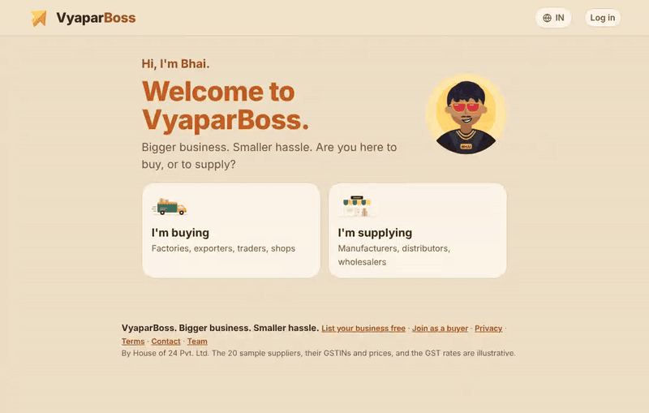
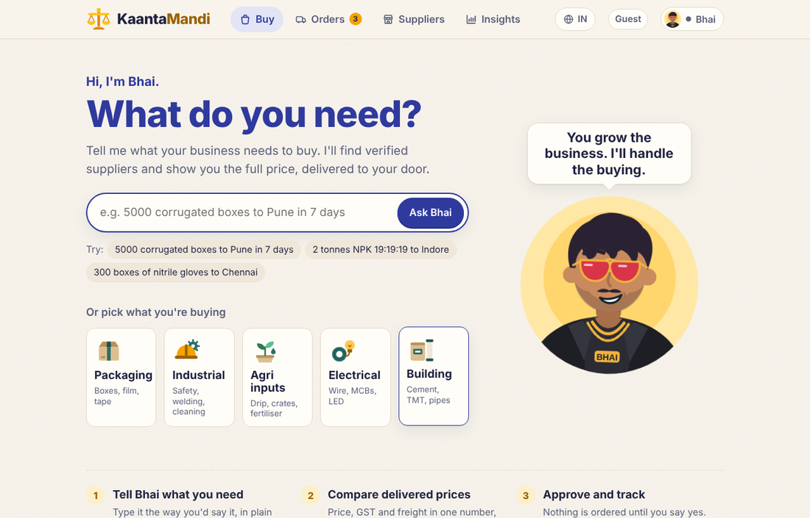
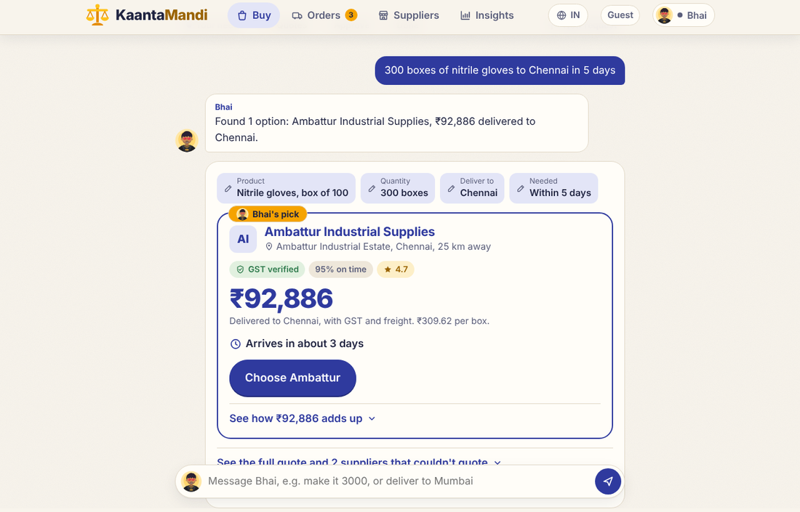
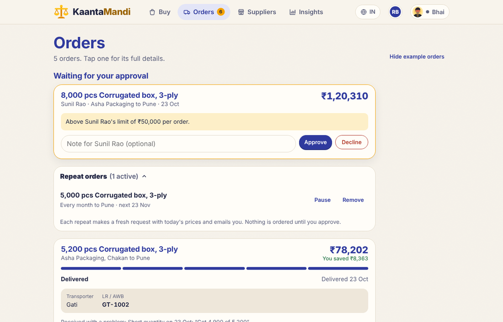
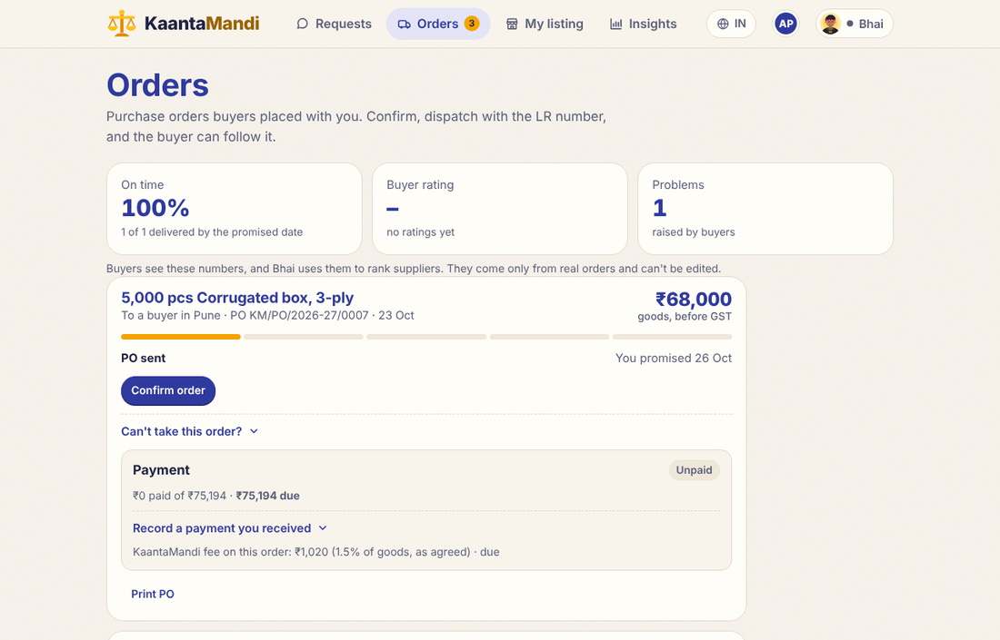
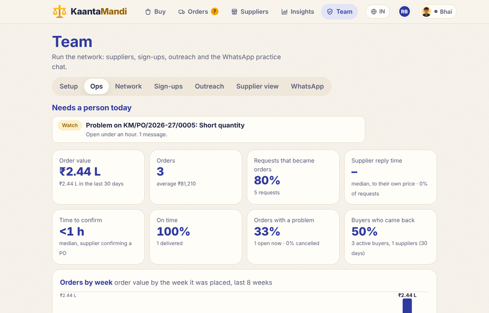
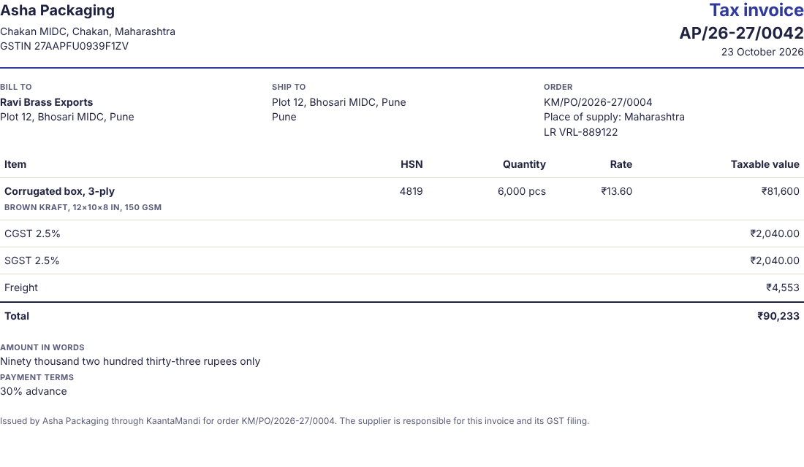

# KaantaMandi

*Formerly VyaparBoss. Domain: kaantamandi.com.*

**AI-assisted B2B procurement for Indian small businesses.** A buyer types what they need in plain English or Hinglish; KaantaMandi finds suppliers who can actually serve that quantity and city, compares them on the **full delivered price** (rate + GST + freight), and places a purchase order only after the buyer approves. Then it tracks delivery, invoices and payments, and builds each supplier's real track record.

[](https://yashrajsurgo0.github.io/VyaparBoss/?lang=en)
[](https://github.com/yashrajsurgo0/VyaparBoss/actions/workflows/test.yml)




> **Try it in a minute:** open the [live demo](https://yashrajsurgo0.github.io/VyaparBoss/?lang=en) → **I'm buying** → **Explore without an account** → type *"5000 corrugated boxes to Pune in 7 days"* → pick a supplier → tick approve → **Place order** → follow it under **Orders**. The demo runs entirely in your browser with example suppliers; nothing is sent anywhere. Pick **I'm supplying** instead to see the supplier side.
>
> Full version with shared data, AI and team tools: [vyaparboss.onrender.com](https://vyaparboss.onrender.com) (free hosting, so the first visit can take about a minute to wake up).

## What it does

| | |
|---|---|
| **Buyers** | Ask in plain words (AI turns it into a structured request) · compare suppliers on delivered price and delivery time · ask every supplier for a better price within their own discount limits · approve, then track dispatch with the LR number · confirm receipt, rate the supplier, raise problems · repeat orders on a schedule · monthly budget · team members with approval limits · GST invoices and payments |
| **Suppliers** | Free self-listing with price tiers, minimum order, capacity and delivery range · only requests they can serve · quote in the app and see their rank (never rivals' prices) · confirm, dispatch, invoice, confirm payments · a track record earned from real deliveries |
| **Operations** | KPI dashboard (order value, conversion, supplier reply time, on-time rate, problem rate, repeat buyers) · alerts for late orders, sourcing gaps and unconfirmed payments · problem resolution · fees and payment settlement · supplier outreach pipeline · setup checklist |

| Buying | Comparing delivered prices |
|---|---|
|  |  |
| **Orders: delivery, problems, payments** | **Supplier side** |
|  |  |
| **Ops command center** | **GST tax invoice** |
|  |  |

## How it's built

- **One engine, two runtimes.** Pricing, freight, GST, ranking, negotiation and the order rulebook are plain JavaScript shared by the browser and a zero-dependency Node.js server, so the static demo and the live server behave the same.
- **AI with guardrails.** Gemini or Claude only reads requests and drafts messages. Prices, availability and suppliers always come from structured supplier data, and nothing is ordered without explicit approval.
- **Ranking that's earned.** Suppliers rank on delivered cost (60%), on-time rate (25%) and rating (15%); real records are blended with neutral defaults so one order can't make or break a new supplier.
- **Built like a real service.** Buyer and supplier accounts (email, Google, Apple, Facebook), per-person data scoping, server-side price checks, hashed sessions, CSP and security headers, signed payment webhooks, account deletion, and a privacy policy written for India's DPDP Act.
- **Tested and shipped automatically.** 61 engine and API tests plus 70+ UI checks run on every push; when they pass, GitHub Actions deploys the demo and the server.
- **Made for India.** Hinglish, Indian English and global English modes, lakh/crore formatting, GSTIN checksums, CGST/SGST vs IGST, nearly 60 cities and export ports.

Built by **Yashraj Surgoniwar**. The 20 example suppliers, their GSTINs and prices are illustrative.

---

## For developers

### Run it

```bash
cp .env.example .env     # optional: add GEMINI_API_KEY (or ANTHROPIC_API_KEY) to switch on AI parsing
npm start                # app + API at http://localhost:5173
npm test                 # engine, parser and API tests (Node 18+, no dependencies)
npm run deploy:pages     # publish src/ to GitHub Pages (gh-pages branch)
npm run build:single     # dist/kaantamandi.html: whole app in one file, for sharing
```

**Two sides, one app:** the welcome screen asks "I'm buying" or "I'm supplying"; each side has its own sign-up/log-in (email, Google, Apple, Facebook; see [docs/SIGN_IN_SETUP.md](docs/SIGN_IN_SETUP.md)) and its own tabs. Buyers: Buy, Orders, a supplier directory with filters (product, ships from, delivers to, distance, quantity, max price, rating, verified, on-time; sort by price, distance, rating), Insights. Suppliers: Requests (quote in the app; see your rank), Orders (confirm, dispatch, deliver), My listing, Insights. Team tools sit under Team (admin key). Buyers can also explore as a guest.

**Regions and languages:** one app, switch in the header. India · Hinglish (default in India), India · English, and Global · English for buyers anywhere sourcing from Indian suppliers (delivery to Indian cities and ports: Nhava Sheva, Mundra, Chennai, Tuticorin…). Link straight to one with `?region=global` or `?lang=en`.

**Live server:** https://vyaparboss.onrender.com (shared data, Gemini AI; Render free plan, so it sleeps when idle and data resets on redeploy).
**Static demo:** https://yashrajsurgo0.github.io/VyaparBoss/ (data stays in your browser). Redeploy with `npm run deploy:pages`.

Two ways the same app runs:

| | Data lives in | Request parsing | Used for |
|---|---|---|---|
| **With the server** (`npm start`) | `data/db.json` on the server, shared by everyone | Gemini or Claude via your API key (rule parser if no key) | Pilot operations, WhatsApp |
| **Static page** (GitHub Pages, claude.ai, opening `src/index.html`) | The viewer's browser | Claude inside claude.ai, otherwise the rule parser | Demos |

The app checks for `api/health` on load and picks the mode by itself.

## API

| Method | Path | Does |
|---|---|---|
| GET | `/api/health` | App, AI and WhatsApp status |
| GET | `/api/state` | Orders, RFQs, onboarded suppliers, settings |
| POST | `/api/parse` | `{text, partial}` → structured requirement (Claude or rules) |
| POST | `/api/quotes` | `{productId, qty, city, deadline}` → ranked landed-cost quotes |
| POST / PATCH | `/api/rfqs`, `/api/rfqs/:id` | Create / update RFQs (server assigns `RFQ-2627-0001` ids) |
| POST / PATCH | `/api/orders`, `/api/orders/:po` | Raise POs (`KM/PO/2026-27/0001`), move stages, flag issues |
| PUT / DELETE | `/api/suppliers/:id` | Onboard, edit or remove a supplier (validated, GSTIN checksum) |
| PUT | `/api/settings` | `{useSamples}`: show or hide the 20 sample suppliers |
| POST | `/api/draft` | AI-drafted supplier reply for an RFQ |
| GET / POST | `/webhooks/whatsapp` | Meta webhook verification and incoming messages (HMAC-checked when `WHATSAPP_APP_SECRET` is set) |
| POST | `/api/whatsapp/simulate` | `{from, text}` → the reply a buyer would get (no message sent) |
| GET | `/api/whatsapp/log` | Recent conversations, phone numbers masked |
| POST | `/api/join` | Public sign-up (rate-limited, honeypot) |
| GET / POST | `/api/quote/:token` | Supplier quote link: see the request, send a price |
| GET / POST | `/unsubscribe` | Signed unsubscribe link from outreach emails |
| * | `/api/admin/*` | Team only (`x-admin-key`): sign-ups, leads, outreach, quote links |
| DELETE | `/api/samples` | Remove sample orders (team only) |
| POST | `/api/auth/signup`, `/login`, `/oauth`, `/logout` | Buyer and supplier accounts (email + password, Google, Apple, Facebook) |
| GET / PATCH / DELETE | `/api/auth/me` | Who's signed in; edit details and email preferences; delete the account |
| POST | `/api/auth/forgot`, `/api/auth/reset`, `/api/auth/password` | Password reset by email (one-hour link), change password |
| PUT / POST | `/api/my/listing`, `/api/my/quotes` | Supplier's own listing and in-app quotes |
| POST | `/api/contact` | Contact page (rate-limited, honeypot); team reads them in Sign-ups |
| GET | `/sitemap.xml`, `/robots.txt` | For search engines |
| PATCH | `/api/orders/:po` `{action}` | confirm, dispatch (transporter + LR), transit, deliver (condition), review, dispute, reply, withdraw, cancel, invoice, pay, payconfirm; team: resolve, approve/reject for team orders. Rules in `applyOrderAction()` |
| POST | `/api/orders/:po/paylink` | Razorpay Payment Link for what's due (when keys are set) |
| POST | `/webhooks/razorpay` | Signed `payment_link.paid` webhook, recorded once |
| POST / PATCH / DELETE | `/api/schedules` | Repeat orders: a fresh request on schedule, never an order |
| GET / POST / PATCH / DELETE | `/api/org`, `/api/org/invites`, `/api/org/join`, `/api/org/members/:id` | Buyer teams with per-person approval limits |
| GET | `/api/admin/ops` | Team: KPIs, weekly order value, alerts, open problems, fees, online payments to settle |

## What's in the prototype

**Bhai** is the built-in buying assistant. The Buy screen starts with one question ("Bolo kya chahiye?") and three category tiles. Each answer reveals the next question (product → quantity → city → date). Then comes Bhai's pick with the delivered price, with the breakdown, all quotes and negotiation one tap away, then confirm and approve.

| Tab | What it does |
|---|---|
| Buy | Talk to Bhai or tap through categories → quotes ranked by delivered cost → ask for a better price → approve → PO |
| Orders | POs (`KM/PO/2026-27/0001`) through PO sent → Confirmed → Dispatched → In transit → Delivered; issue reporting |
| Suppliers | Network: onboard real suppliers (GSTIN checksum, products, price tiers, MOQ, capacity, delivery radius, negotiation limit); 20 sample suppliers you can hide |
| Suppliers → Supplier view | What a supplier sees: requests they qualified for, auto-quote, rank, drafted WhatsApp reply |
| Insights | Value bought, buyer savings, request→order conversion, platform revenue, spend by category, WhatsApp practice chat |
| Insights → Outreach (team) | Import lead CSVs, email templates in Bhai's voice, preview, send with daily cap and unsubscribe, or download for mail merge |
| Suppliers → Sign-ups (team) | Everyone who signed up at `#join`, with WhatsApp links; one tap to onboard as a supplier |
| `#join` | Public 2-minute sign-up for suppliers (free listing) and buyers |
| `#quote/<token>` | A supplier sends their own price for one request; it replaces the rate-card estimate |
| Orders → Order again | Repeat a past order with fresh prices |

Categories live: packaging (incl. export pallets and container desiccants), industrial consumables, agri inputs (16 products). 55 cities, including tier-2/3 export clusters (Moradabad, Kanpur, Karur, Panipat, Tiruppur, Morbi, Silvassa…).

Team tools need `ADMIN_KEY` on the server. In Global mode, prices also show an indicative US$ figure (rate and date in `USD_RATE`, `src/js/i18n.js`). The site has link-preview tags (`og.png`) and a web app manifest, so it can be added to a phone's home screen. Outreach setup and rules: [docs/OUTREACH.md](docs/OUTREACH.md).

## Code map

```
server/
  index.js          HTTP server: static files + JSON API (no dependencies)
  core.js           loads src/js engine into Node so server and browser share one engine
  store.js          JSON-file database (data/db.json)
  remote.js         optional Upstash copy so data survives redeploys on a temporary disk
  auth.js           accounts, sessions, Google/Apple/Facebook token checks, password reset
  notify.js         account emails: reset links, new requests, quotes, order updates, approvals, repeat orders, payments
  razorpay.js       optional online payments (Payment Links + signed webhook)
  gemini.js         Google Gemini API client
  anthropic.js      Anthropic Messages API client
  whatsapp.js       WhatsApp Cloud API: webhook, conversation state, APPROVE flow, order updates
  email.js          outreach email via Brevo or Resend, signed unsubscribe links
scripts/            build-single.js, wa-simulate.js
render.yaml         one-click Render deploy with a persistent disk
src/
  index.html        page shell + all drawings (logo, Bhai, illustrations, icons) as inline SVG symbols
  styles.css        design tokens (peacock teal, marigold, kraft; light + dark), Baloo 2 + Mukta type
  js/data.js        products, cities, sample suppliers (rate-card tiers, MOQ, capacity, coverage)
  js/util.js        ₹ formatting (en-IN), distance, Indian FY
  js/engine.js      state + discovery, tier pricing, GST, freight, ranking
  js/parser.js      Buyer Intelligence Agent: Hinglish rule parser, Claude prompts, output sanitising
  js/repo.js        storage: server API when available, otherwise localStorage
  js/app.js         UI rendering and event wiring
  js/grow.js        sign-up and quote pages, sign-ups, outreach, quote links
  js/roles.js       welcome/sign-in, buyer and supplier tabs, directory filters, account settings
  js/page.js        privacy, terms, contact and 404 pages
tests/            engine.test.js, server.test.js, ui.smoke.js (drives the Buy flow in a fake DOM)
docs/               PROJECT_BRIEF.md, DEPLOY.md, WHATSAPP_SETUP.md
```

## Model assumptions (all illustrative — validate in the pilot)

- Landed cost = tier unit price × qty + GST (IGST inter-state, CGST+SGST intra-state) + freight.
- Freight: part load ₹2.50/kg + ₹0.006/kg/km (min ₹1,200); full truck ₹9,000 + ₹38/km per 9 t, whichever is cheaper.
- Road distance = straight-line × 1.3; transit 1 day per 450 km.
- Ranking: 60% landed cost, 25% on-time rate, 15% rating; suppliers missing the deadline are listed separately.
- Take rate 1.5% of goods value.
- Suppliers, GSTINs, prices and GST rates are sample data.

## WhatsApp

Buyers text the business number in English, Hindi or Hinglish. The server parses the message, asks for anything missing, and replies with the top 3 landed-cost quotes. When the buyer replies **APPROVE 1**, it raises the PO, and stage changes go back to the buyer.

- Try it without Meta: **Insights → Bhai on WhatsApp** (server mode), or `npm run wa -- "5000 3-ply boxes Pune 7 din"`.
- Connect a real number: [docs/WHATSAPP_SETUP.md](docs/WHATSAPP_SETUP.md). Put the server online first: [docs/DEPLOY.md](docs/DEPLOY.md) (Render blueprint included).

## AI

AI reads buyer messages and drafts supplier replies. It never sets prices or picks suppliers: those come from supplier rate cards through `engine.js`, and model output is validated by `cleanParsed()` before use.

- With the server: set `GEMINI_API_KEY` (Google, model `gemini-3.8-flash` by default, override with `GEMINI_MODEL`) or `ANTHROPIC_API_KEY` (Claude, `claude-haiku-5-5`). If both are set, Gemini is used.
- As a claude.ai artifact: uses the artifact runtime's Claude access.
- Anywhere else: the built-in Hinglish rule parser.

## Roadmap (next)

1. Onboard the first 10–15 real suppliers and hide the samples.
2. Connect the WhatsApp number (code ready; needs a Meta business admin).
3. WhatsApp message templates for dispatch updates after 24 hours.
4. Move from `db.json` (+ Upstash copy) to Postgres once there are many concurrent users.
5. Live freight quotes from a 3PL partner; GST rates by HSN from a maintained table.
6. Payments through a licensed gateway; e-invoice generation.
